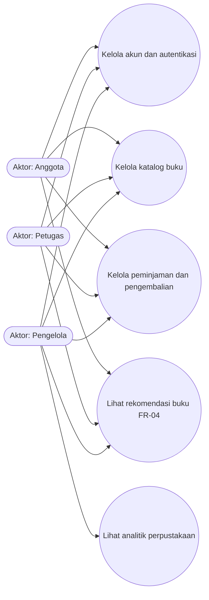
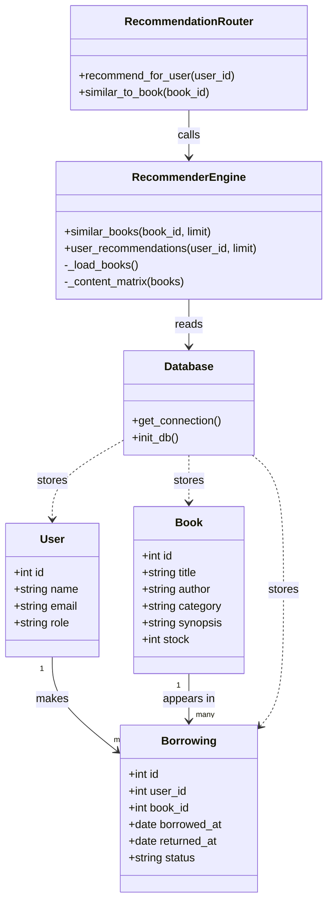
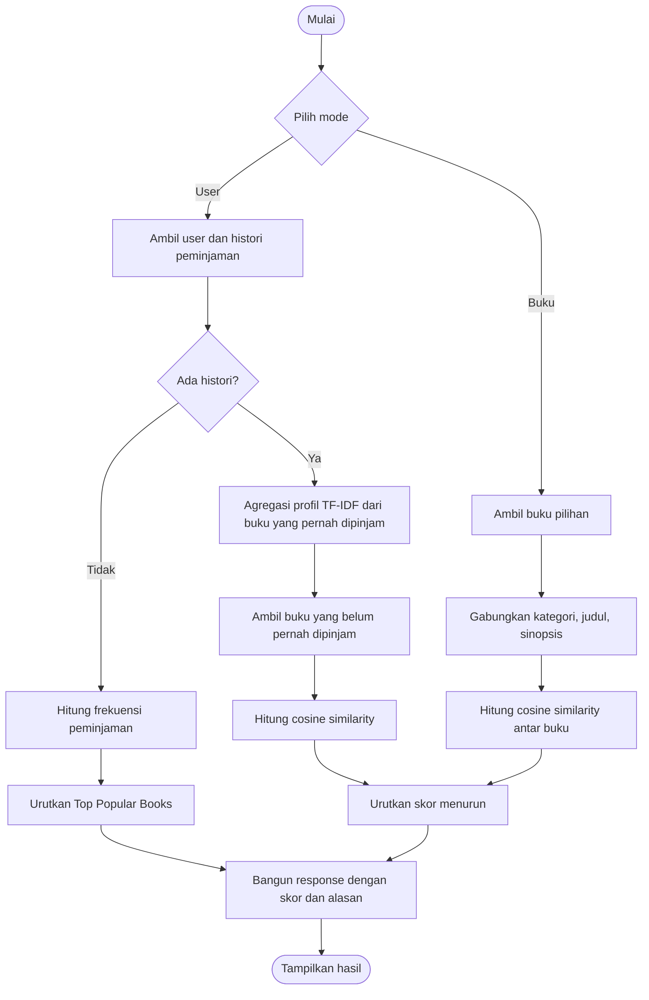
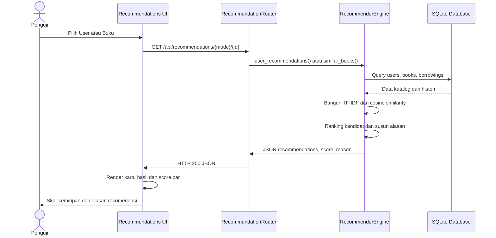

# Smart Library RecSys

Fondasi full-stack Tugas Besar Rekayasa Perangkat Lunak. Backend memakai FastAPI, database SQLite, template Jinja2, dan Tailwind CSS melalui CDN. FR-04 memakai hybrid book recommendation engine berbasis TF-IDF dan cosine similarity.

## Struktur kerja tim

```text
smart-library-recsys/
├── main.py                         # Entry point FastAPI dan registrasi router
├── database.py                     # SQLite, schema, koneksi
├── seed_data.py                    # 50 buku, 10 user, 80 transaksi deterministik
├── services/
│   └── recommender_engine.py       # Implementasi FR-04, dimiliki Lead Engineer
├── routers/
│   ├── auth.py                     # Anggota 4, Rifa
│   ├── books.py                    # Anggota 3, Dhia
│   ├── circulation.py              # Anggota 2, Wildan
│   ├── recommendations.py          # Lead Engineer, FR-04
│   └── analytics.py                # Anggota 5, Azrur
├── templates/
│   ├── base.html                   # Layout dan sidebar
│   └── recommendations.html        # UI simulasi FR-04
├── static/style.css
├── requirements.txt
└── vercel.json
```

Setiap anggota bekerja di router atau service yang ditugaskan. `main.py`, `database.py`, schema, dan kontrak endpoint menjadi area integrasi Lead Engineer. Perubahan lintas modul dibahas sebelum merge untuk menjaga konflik Git rendah.

## Menjalankan lokal

Python 3.10+ dibutuhkan.

```powershell
python -m venv .venv
.\.venv\Scripts\Activate.ps1
python -m pip install -r requirements.txt
python seed_data.py
python -m uvicorn main:app --reload
```

Buka `http://127.0.0.1:8000/rekomendasi`. Health check tersedia di `http://127.0.0.1:8000/health`.

Seed aman dijalankan ulang karena mengisi ulang tiga tabel demo. Database lokal `library.db` tidak perlu dibuat manual.

## Kontrak FR-04

- `GET /api/recommendations/user/{user_id}`: rekomendasi personal. User dengan histori memakai profil TF-IDF dari buku yang pernah dipinjam. User tanpa histori memakai fallback buku paling populer.
- `GET /api/recommendations/similar/{book_id}`: content-based filtering untuk buku serupa.
- `GET /rekomendasi`: halaman interaktif untuk memilih user atau buku, membaca skor cosine similarity, dan melihat alasan rekomendasi.

Feature text engine adalah gabungan `kategori + judul + sinopsis`. Matrix dibuat saat request agar seed atau perubahan katalog langsung terbaca dan penggunaan RAM tetap ringan untuk laptop lokal.

## Deployment Vercel

`vercel.json` mengarahkan seluruh request ke `main.py` menggunakan builder Python Vercel. SQLite cocok untuk demo dan tugas lokal. Untuk deployment production multi-instance, database perlu dipindahkan ke storage persisten terkelola karena filesystem serverless tidak menjamin persistensi write.

## Diagram Mermaid FR-04 dan sistem

### Use Case Diagram



### Class Diagram



### Activity Diagram FR-04



### Sequence Diagram FR-04


